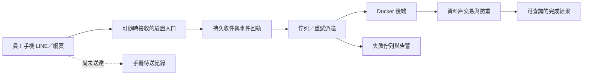

# 考勤系統離開 Zeabur：可靠打卡與遷移規劃

查核日期：2026-10-28（Asia/Taipei）。本文件是檢查結果與待實作方案；未變更應用程式、正式資料、雲端設定或部署。

後續實作入口：2026-10-29 的新修補、測試與分支狀態見 [Cloud Run 實作驗證紀錄](CLOUD_RUN_IMPLEMENTATION_VERIFICATION_20261029.md)。以下「未實作／未重跑」與測試數保留為當時盤點，不代表最新實作狀態。

2026-10-29 規劃更新：**Railway 暫時移出候選**，本文件以 LINE 考勤 Docker 搬遷與重新啟用為範圍。以下平台建議已更新；62 項測試與 4 項故障重現仍是 10 月 28 日紀錄，規劃更新時沒有重跑。平台排除屬本次選型限制，不代表本文件已查證特定資安事件。

## 結論

考勤第一階段應使用常駐主機，並先修正手機打卡的防重複機制。常駐能減少冷啟動等待，但無法解決手機斷線後「已寫入、卻沒收到成功回應」的問題。目前不能直接將現有打卡 POST 放入佇列重送。

截至 2026-10-28 核對的 main 已有 Cloud Run 冷備援／active 適配。排除 Railway 後，暫定優先驗證 **Cloud Run 常駐 service 作主機**；若持久檔案或背景工作適配會延誤搬遷，改評估 **Google Compute Engine 一般常駐 VM＋Docker＋持久磁碟**。Cloudflare 可靠收件層列第二階段，不阻擋先搬家。這是候選與驗收路線，並非已替使用者更換平台或確認上線。

主要入口為「員工手機透過 LINE／網頁打卡」。以下以此為主，樹莓派快取腳本不算現有手機端的保護。

## 1. 來源與實際部署

| 項目 | 本次確認 |
| --- | --- |
| Canonical repo | `pcedison/salary-count-barcode-scan-public`，主分支 `main` |
| GitHub main／本次檢查基準 | `91cfc847b5e4c26504f05690106b5d6311463008`，已合併 PR #117 `deploy/railway-cloudrun` |
| 套件版本 | `2.2.9`；版本號不等同部署 SHA |
| 原始 checkout | 未修改；未將本機個人路徑納入公開紀錄 |
| 本次隔離 worktree | 另建的 Git worktree，指令以其 repository 根目錄執行 |
| 本次本地分支 | `codex/attendance-migration-audit-20261028`，尚未 commit／push |
| 來源平台部署資訊 | 實際服務識別與入口保留在本地交接紀錄；正式切換前另核對部署 SHA |
| 來源平台持久儲存 | 公開文件只記錄須驗證持久儲存的要求；本次未掛載、重啟或部署 |
| Railway／Cloud Run 實際部署 | 本次未查其帳戶與正式設定；repo 內有腳本不代表平台已配置或已完成搬遷 |

閱讀範圍包含 README、套件與測試設定、架構、設定、部署與維運文件、Dockerfile，以及 LINE／掃碼／儲存／背景服務來源。原有 [部署文件](RAILWAY_CLOUDRUN_DEPLOYMENT.md) 只供核對既有實作；其中 Railway 建置／雙平台發布路線已暫停，不能照舊執行，亦不能單靠健康檢查結果認定打卡可接手。

## 2. 主要流程與實際重現

現有流程為：手機載入頁面 → LIFF／網頁登入 → POST `/api/line/clock-in` → 依當日有無未下班紀錄選擇上班或下班 → 寫入資料庫 → 回覆成功。LINE 通知是寫入後另外呼叫。

這是手機頁面的 HTTP 請求；現有 LINE webhook 只驗簽、過濾與記錄事件，沒有呼叫打卡寫入。因此不能依賴 LINE webhook 重送來保障手機打卡。

| 編號／等級 | 結果與影響 | 證據 |
| --- | --- | --- |
| A1／P2 | 回應遺失後，相同 POST 重送會切換成下班。原前端在判定離線時會自動重試，包括 POST；隔離實測得到 1 次新增＋1 次更新，同分鐘上班與下班 | `client/src/lib/queryClient.ts:86–94`、`server/routes/line/clockin.routes.ts:49–72`；`line-response-loss-replay.json`、`line-client-automatic-replay.json` |
| A2／P2 | 兩個請求同時讀到沒有未下班紀錄，均新增上班。此 LINE 路徑未使用條碼路徑的原子更新／鎖，也沒有事件唯一性保護 | `server/routes/line/clockin.routes.ts:49–73`、`server/storage.ts:443–454`、`shared/schema.ts:49–63`；`line-concurrent-duplicate.json` |
| L1／補送限制 | 超過 5 分鐘或未來的 clientTimestamp 改用伺服器當下時間。24 小時前的合成事件實測收到 200 成功，記錄的是現在；這是目前時間政策，不能當成支援離線補送 | `server/routes/line/clockin.routes.ts:36–48`；`line-delayed-event-time.json` |
| L2／時間限制 | 手機時間是在 LIFF 初始化後擷取，不能宣稱是真正掃到 QR code 的時間；首次開頁本身也可能等待冷啟動 | `client/src/pages/ClockInPage.tsx:109–113` |

A1、A2 是最新 main 來源與隔離測試確認的缺陷；未查員工正式紀錄，不表示已確認發生正式考勤誤記。並行測試使用儲存模擬與讀取屏障，另以來源 schema 核對；尚未在實際 PostgreSQL 重跑。

### 最短重現步驟

1. A1：以合成已驗證 LINE 身分送出上班 → 讓路由完成寫入後切斷回應 → 送出完全相同 body。第二次會回覆下班。另一測試執行原 `apiRequest`，模擬 `navigator.onLine=false`，確認它會自行造成相同重送。
2. A2：使兩個有效請求同時完成「查不到當日紀錄」→ 放行各自新增。兩個回應都是上班、產生不同紀錄 ID。
3. L1：送出 24 小時前的 `clientTimestamp`。回應成功，但日期時間取伺服器現在。

## 3. 常駐或暫存的選擇

| 方案 | 現有程式適配程度 | 本次建議 |
| --- | --- | --- |
| Cloud Run service 常駐主機 | 已有 active 模式 `min-instances=1`、`no-cpu-throttling` | 暫定優先驗證；需外部持久檔案、LINE 入口與背景工作恢復設計，常駐運算會持續計費 |
| Compute Engine 一般常駐 VM＋Docker | 可保留長駐程序與本機檔案路徑，尚未適配驗收 | 若 Cloud Run 適配會拖慢搬遷則評估；需持久磁碟、OS／Docker 更新、HTTPS、監控、備份及重啟恢復，不使用 Spot 或定時停機 |
| Cloudflare 收件層＋可休眠 Docker 後端 | 目前沒有手機可靠收件契約與持久回執 | 第二階段；完成事件防重、認證、持久收件、狀態查詢與重播驗收後才可依賴 |

Cloud Run 與具請求喚醒設計的 Cloudflare Containers，不是一定要等到某個預定時間才啟動；請求可觸發喚醒。但等待時間、逾時及重送仍存在。Cloud Run 保留至少一個 instance，配合 instance-based billing／持續配置 CPU，較符合目前程序內排程；平台仍可能重啟，不能視為零停機保證。[Cloud Run 擴縮文件](https://docs.cloud.google.com/run/docs/about-instance-autoscaling)、[最低 instance 文件](https://docs.cloud.google.com/run/docs/configuring/min-instances)、[Cloudflare Containers 架構](https://developers.cloudflare.com/containers/concepts/architecture/)。

Railway 已依使用者要求移出候選，舊腳本保留但不啟用。若採 Compute Engine，依現行官方指引用 startup script／cloud-init 啟動 Docker 與掛載持久磁碟，不使用已停用的舊 container startup agent。[官方遷移方式](https://docs.cloud.google.com/compute/docs/containers/migrate-containers)。本次沒有核對個人帳戶額度或估算月費。

2026-10-29 補查：`cloudrun-env.sh activate` 只調整運算設定，沒有替換 LINE／網域；一般 `update` 對 callback／origin 等受管理變數又有跳過規則。不能把 active 成功當成主機轉移完成，需另寫可核對的主機設定與 LINE 切換步驟。

## 4. 第一階段：搬遷前必要修補與驗收

1. **為每次打卡建立穩定事件 ID 與回執。** 手機首次操作建立 ID，首次送出前保存待確認 ID 與最小必要內容，重試沿用。重整、關頁重開或重新登入後先恢復／查核原事件，未確認前不得因「重新開始」建立新事件；本地紀錄遺失時走伺服器回執查詢或人工核對。這項恢復機制屬第一階段，不必等完整離線佇列。伺服器由已驗證身分決定員工；事件收件／考勤更新／結果回執在資料庫交易內完成，以唯一鍵防重。相同 ID＋相同內容回傳原結果；相同 ID＋不同內容拒絕。不能單靠前端關按鈕、短時間記憶體去重或 instance 上限。
2. **定義上下班意圖並原子處理。** 可維持簡單掃碼體驗，但第一次判定的動作與結果必須綁定事件，重送不得再重新切換。不同 ID 的並行操作仍需依員工與班次序列化／版本檢查，避免把兩個重複操作當兩個有效動作；不能用「同一天只能一筆」破壞既有多段出勤。
3. **處理結果不明。** 網路中斷後用事件 ID 查詢結果或安全重送同一事件，不能立即建立新事件。「已完成」只在資料庫確認後顯示；通知寄送失敗不回滾出勤，也不能重做出勤來補通知。
4. **保留現有安全檢查。** LINE 身分與綁定、停用員工、登入、來源／CSRF、限流及管理員權限維持。不得為讓備援寫入而開放匿名打卡。結構調整採新增表／索引，先在隔離資料庫演練，不刪除或重建正式表。
5. **背景工作只有明確的執行者。** `runtime-services.ts` 在每次 Web 啟動時啟動監控、備份、retention、LINE 清理與月結。冷備援喚醒也立即跑 retention；`SALARY_AUTOMATION_ENABLED=false` 只停月結。需新增可驗證的主／備角色與跨程序工作鎖或租約；不能把程序內單例當成跨平台排他保護。若容許兩邊 retention，必須另外證明併發安全並明訂權責。
6. **保存檔案並驗證還原。** 備份、稽核 log、薪資 PDF 現在均有本機輸出。若採 VM，持久掛載須連同 `APP_RUNTIME_DIR` 的 PDF 一起覆蓋；Cloud Run 則需物件儲存或其他外部持久保存。另做加密備份與還原演練，不能只以「有檔案／服務常駐」認定可恢復。應分別確認容器檔案與外部 PostgreSQL 的持久保存。
7. **背景工作中斷恢復。** 月結已有資料庫 claim 與 Resend 防重，但程序終止可能留下 `running`。需用虛構薪資／測試郵件攔截器演練中斷、接手與人工處理，不直接重設正式狀態或重寄。
8. **可操作的主備切換。** 優先穩定網域，核對 LINE Login callback、LIFF Endpoint、Webhook、允許來源與安全 cookie。改用不同網域時，僅共用 `SESSION_SECRET` 不會搬移 host-only cookie，須預期重新登入。切換前凍結舊主機的可寫角色；主備共用外部 PostgreSQL 只提供應用程式備援，沒有消除資料庫單點。

## 5. 第二階段：手機與雲端可靠暫存



- 收件入口、登入驗證與基本頁面不能全部依賴正在休眠的後端，否則首次掃碼仍無法完成可靠收件。Cloudflare Workers 可承擔入口；後端仍可使用既有 Docker，不必把整個薪資系統重寫為 Worker。
- 認證後先持久保存事件與伺服器接收時間，成功後才回「已收件，等待入帳」與可查詢回執；只有入帳完成才顯示「打卡完成」。收件資料與佇列送出之間也要能恢復，例如資料庫 outbox／補派送程序，避免存了事件卻沒排進佇列。
- 手機僅本地暫存時明確顯示「尚未送達」。LINE 內建瀏覽器關閉後不保證繼續執行，儲存也可能被清除；需重開頁面可查待送狀態，無法把手機暫存當成雲端已收到的保證。首次離線又沒有已載入頁面時，保留補登程序。
- 事件包含不透明 ID、動作／班次版本、經驗證的員工關聯、裝置觀察時間、伺服器接收時間、處理時間與狀態。避免保存完整 LINE access token、身分證或不必要薪資資料於手機／佇列。機密只在伺服器受控保存；權限、加密與保留期限需明訂。
- 員工手機時間不能直接視為可信出勤時間。短延遲可依政策採伺服器接收時間；真正離線、超時、跨日、跨班次或時間衝突轉人工覆核，保留原始觀察資訊，不悄悄改成補寫當下。不得藉此放寬原本防止任意回填時間的保護。
- 佇列可能重複或亂序送達。以事件唯一鍵、每員工／班次序列、交易與結果回執確保一次業務效果；只有資料庫提交後才能確認處理完成。設定有限重試、失敗佇列、告警、保留期限及人工重播入口。[Cloudflare Queues 傳遞保證](https://developers.cloudflare.com/queues/reference/delivery-guarantees/)、[失敗佇列](https://developers.cloudflare.com/queues/configuration/dead-letter-queues/)。
- 「雲端已收件」需要能承受後端暫停；如果收件層也使用同一個無法連線的 PostgreSQL，就不能保證資料庫故障時仍可收件。是否建立獨立持久收件庫，依明確故障範圍與成本選擇，不預設多加一套資料庫。

## 6. 本次實際驗證

執行環境：Windows、Node `v24.16.0`、npm `11.13.0`，上述隔離 worktree。先檢查依賴腳本與測試入口，沒有啟動完整伺服器。

```powershell
npm ci --ignore-scripts --no-audit --no-fund
node tmp/migration-audit/verifier/run-tests.mjs
node tmp/migration-audit/verifier/run-tests.mjs repro
```

| 實際執行項目 | 結果 |
| --- | --- |
| 鎖定依賴安裝，停用 lifecycle scripts | 成功，468 packages；未跑 npm audit |
| 9 個既有相關測試檔：掃碼、LINE auth／clockin／webhook、服務、安全與同步狀態 helper | 62 通過、0 失敗、0 跳過 |
| 本次 4 個故障觀察：回應遺失重送、原前端自動重試、並行上班、舊時間補送 | 4 項均成功重現；這表示確認缺陷／限制，不是可靠性驗收通過 |
| 來源平台瀏覽器檢查 | 唯讀確認部署與儲存資訊，詳細識別保留本地交接紀錄；沒有操作員工打卡 |

隔離方式：測試設定 `envDir:false`；子程序只繼承作業系統必要變數，不載入 `.env`；實際 DB constructor 被測試 mock 阻擋；LINE 通知為 mock；HTTP 僅 `127.0.0.1` 隨機埠且測後關閉。網路守衛記錄 70 次連線均為 loopback，禁止的外部連線嘗試為 0。

未執行：完整測試套件、build／typecheck、真 PostgreSQL 競態測試、真手機／LINE 操作、Cloud Run／Cloudflare 冷啟動、雲端部署、正式薪資／郵件／備份還原。此次只新增調查文件與忽略目錄內的合成驗證，不能稱已完成平台遷移或桌面／手機端到端驗收。

本地證據都在 Git 忽略的 `tmp/migration-audit/`，不包含正式員工資料或憑證；清除該目錄會移除本次重現入口：

- `verifier/summary.json`：執行環境、測試檔清單、來源雜湊與限制。
- `verifier/existing-tests.log`、`verifier/repro-tests.log`：執行輸出。
- `verifier/line-reliability.repro.test.ts`：4 項合成重現。
- `verifier/line-*.json`：每項實際觀察。
- `review-ledger.json`、`review-evidence.json`、`review-spec.json`：Jev 來源、決策與後續驗證索引。

## 7. 搬遷驗收與時程

| 階段 | 通過條件 |
| --- | --- |
| 可靠寫入 | 回應丟失後相同事件重送只生效一次；不同事件的並行衝突可解釋；DB 真交易測試通過 |
| 手機驗收 | 實際 LINE、iOS／Android 瀏覽器完成登入、上班、提早下班；測試斷線、關頁、重開、快速重掃、時間過期及跨日，狀態不誤導 |
| 常駐與背景工作 | 無流量期間排程可執行；重啟後可恢復；只有指定主機執行需排他工作；備援健康檢查不觸發未授權寫入 |
| 持久保存 | 容器重新部署後仍取得 PDF／稽核紀錄；隔離環境完成備份解密、還原及數量核對 |
| 切換與回復 | 核對部署 SHA／image digest，測試 LINE callback 與重新登入；切換時只有一個可寫主體，回復不遺失或重做已接收事件 |
| 可選收件層 | 後端停止期間仍可持久收件，恢復後防重／順序正確；超時與失敗項有告警、可查回執及人工處理 |

建議順序：先修 A1／A2 → 隔離真 DB 與手機測試 → 完成持久檔案與主備工作權責 → 常駐遷移演練 → 核准切換 → 再評估是否需要休眠＋收件層。平台帳戶／費用、正式部署 SHA、資料庫方案及伺服器到期日仍待核對；本文件不要求讀出或公開任何秘密。

官方公告指出 Zeabur 自 **2026-12-01** 起陸續停止部分服務，**2026-12-31** 全部停止；並非每個服務都能用到月底。建議以 **11 月底前完成驗收與切換**為目標，實際專用伺服器到期日另查；本次沒有操作退款、續費或搬移。[Zeabur 官方停止營運公告](https://zeabur.com/zh-TW/blogs/zeabur-is-shutting-down)。

## 8. Jev 使用紀錄與本次交付狀態

真正使用 Jev 的決策是「手機打卡可靠性調查應優先重現哪個情境」。合法候選為回應遺失重送、並行手機請求、延遲時間、補查證據；不同選擇會改變驗證順序。前期樹莓派候選在使用者澄清後撤換，沒有送 API。

- 實際語意 API：1 次，非快取。receipt `6e71ad66516a403fa21bca1a924c6412`；model `jev-1.13.0`；usage 5,229 input／62 output tokens。
- 採用 `response_lost_replay`；confidence `0.61` 只代表分布集中程度，不是正確率或遷移通過率。
- 送出與採用前以 `jev_evidence --spec` 核對 7 段原始來源的雜湊、位移與 payload 一致；回讀索引保留於上述本地證據。
- 實際後續行動：先測回應遺失與原前端自動 POST 重送，再測並行；4 項觀察完成。固定 Git、檔案與測試數量查核由工具執行，沒有製造額外語意請求。
- 重用既有認證，未建立／修改金鑰；Jev session 已停止。未將正式人事資料、環境憑證或原始正式日誌送入審核。

本次歷史盤點只新增這份規劃及忽略目錄內的驗證證據。該時點未修改生產程式或正式資料，沒有 commit、push、PR、合併或部署；其他工作區均保留。

2026-10-29 追加查核：真正 Jev Choice 選擇先查 LINE 入口相容性，將原「檔案外置優先」改為先追讀 callback／LIFF／origin 設定；沒有重新裁決使用者排除 Railway 的條件或工作順序。receipt `29fae83e99ad4ed8b11d5600207e1835`、`jev-1.13.0`、5,357 input／65 output tokens、1 次非快取；8 段來源在送出與採用前核對一致，另存 12 段追讀。證據為 Git 忽略的 `tmp/migration-audit-20261029/review-ledger.json`；session 已停止。結論是 active 模式不足以完成 LINE 入口切換，尚未選定最終平台，也未驗證正式設定。僅更新規劃與舊 runbook 的停用提示，沒有改應用或部署程式。
